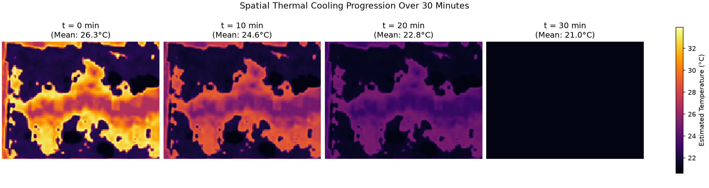
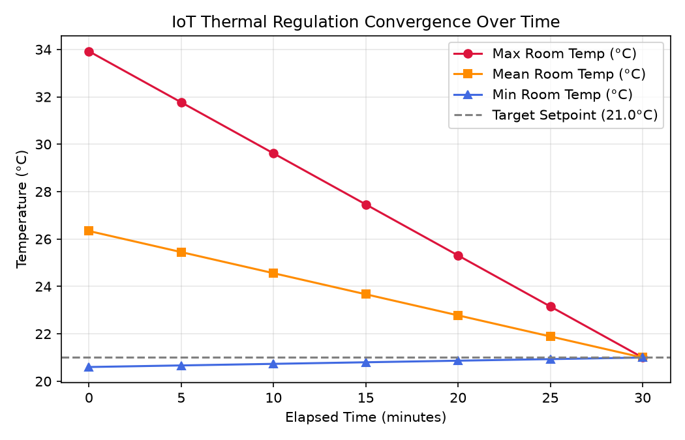

# IoT Thermal Energy Optimization & Spatial Cooling Simulation

A Python thermal image analysis and HVAC regulation prototype designed to analyze indoor spatial heat distribution from thermal sensor bitmaps and model energy-efficient cooling convergence within a fixed room space.

> **Recognition:**
> - **Bronze Medallion** — Waterloo-Wellington Science & Engineering Fair (2022)


## Methodology
1. **Binary Bitmap Decoder (`src/bitmap_utils.py`):** Parses raw 24-bit BMP file headers, byte offsets, row padding, and RGB pixel matrices from scratch without high-level image dependencies.

2. **Spatial Temperature Mapping (`src/thermal_simulation.py`):** Converts RGB thermal sensor captures into 2D spatial temperature grids (°C) to identify localized heat zones.

3. **Thermal Regulation Simulation:** Models progressive temperature convergence (minimum, mean, and maximum room temperatures) toward an optimal HVAC target setpoint over time to minimize over-cooling energy waste.


## Simulation Results

### Spatial Cooling Progression (0–30 Minutes)


### Temperature Convergence Curve



## Setup & Usage
```bash
pip install -r requirements.txt
python src/thermal_simulation.py
```

Generated thermal maps and temperature convergence plots are saved to `results/`.
